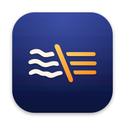

<p align="center"></p>

# Lirnyk

macOS menu-bar app that rephrases the selected text in any app with AI: [OpenRouter](https://openrouter.ai), OpenAI, Anthropic, Gemini, or a local model through [Ollama](https://ollama.com).
Select text, press a profile hotkey, and the selection is replaced with the rewritten text. ⌘Z undoes it.

## How it works

1. You press a profile's global hotkey (for example ⌃⌥F) while text is selected.
2. Lirnyk saves your clipboard, sends ⌘C, and reads the selection from the pasteboard.
3. It sends the text to the selected AI provider. The profile's prompt is the system prompt and the selected text is the user message.
4. When the answer arrives, Lirnyk returns focus to the original app if needed, pastes the result with ⌘V,
   and restores your clipboard. The selection's leading and trailing whitespace is kept.

While a request runs, the menu-bar icon pulses and a small HUD near the cursor shows progress. Press **Esc** to cancel.
If something goes wrong (nothing selected, missing API key, HTTP error, truncated or empty answer),
the HUD shows the error, nothing is pasted, and your clipboard is restored.

The app has no Dock icon. It starts at login by default.

## Requirements
- macOS 14+
- Xcode 26, XcodeGen (`brew install xcodegen`)
- An API key for OpenRouter, OpenAI, Anthropic or Gemini, or [Ollama](https://ollama.com) running locally

## Build & run
    make test      # unit tests
    make build     # Debug build
    make install   # Release build → /Applications/Lirnyk.app and launch
    make release   # notarized DMG + release notes in build/release/ (see docs/releasing.md)
    make notes     # regenerate release notes for the current version from CHANGELOG.md
    make clean     # remove build/ and the generated Xcode project

`Lirnyk.xcodeproj` is generated from `project.yml`. Every make target regenerates it, so edit `project.yml`, not the project.

On first launch grant **Accessibility** (System Settings → Privacy & Security → Accessibility),
then pick a provider and enter its API key in Settings. With Ollama, pick a model you've pulled (`ollama pull llama3.2`).

## Settings
- **General**: AI provider (OpenRouter, OpenAI, Anthropic, Gemini or Ollama), the provider's API key
  (stored in the Keychain) and model (one model for all profiles, picked from a list or typed), *Test*, and launch at login.
  Each provider keeps its own key and model, so switching back and forth loses nothing.
  A warning about Accessibility appears at the top only while access is missing.
  Default models: OpenRouter `openai/gpt-4o-mini`, OpenAI `gpt-4.1-mini`, Anthropic `claude-haiku-5-5`, Gemini `gemini-2.5-flash`,
  Ollama `llama3.2:latest`.
- **Ollama** needs no key. Set the server address (default `http://localhost:11434`); the model list shows the models
  installed on that server. Requests to Ollama time out after 120 seconds, since a model may need to load first.
- **Profiles**: add, remove and edit profiles, and try a prompt on sample text.
- **About**: the installed version, *Check for Updates* and *Check automatically* (on by default: shortly after launch,
  then once a day). When the latest [GitHub release](https://github.com/cheyako/lirnyk-app/releases) is newer,
  the menu bar menu and About link to it.
  The automatic check asks `lirnyk.app` and sends only the Lirnyk version and the macOS major version; we count these
  checks per day, nothing else (no user ID, no cookies, no stored IPs). If `lirnyk.app` doesn't answer, Lirnyk asks
  GitHub directly. *Check for Updates* always asks GitHub and isn't counted, and turning the automatic check off
  stops the counting. See the [privacy page](https://lirnyk.app/privacy).

## Versioning and releases
The version lives in `project.yml`: `MARKETING_VERSION` (shown in Settings, used for the DMG name and the `vX.Y.Z`
release tag) and `CURRENT_PROJECT_VERSION` (build number, bumped with every release).
User-facing changes go in [CHANGELOG.md](CHANGELOG.md) under *Unreleased*; `make notes` turns a version's section
into GitHub release notes. The five release steps (bump, commit, `make release`, tag, publish) are in
[docs/releasing.md](docs/releasing.md).

## Profiles
Each profile has a title, a global shortcut and a prompt. The prompt is sent as the system
prompt and the selected text as the user message. The prompt controls everything, including the output language.
Defaults: Friendly ⌃⌥F, Corporate ⌃⌥H, Tech ⌃⌥O.

Profiles are stored in `~/Library/Application Support/Lirnyk/profiles.json`. You can also run a profile from the menu-bar menu.

## Project layout
```
Lirnyk/
  App/          entry point, AppDelegate (dependency wiring), AppState (busy flag, icon animation)
  Model/        Profile, AIProvider, ProfileStore (JSON), SettingsStore (UserDefaults + Keychain), Keychain
  Services/     AIClient (all providers), clipboard SelectionService, KeyEventPoster (⌘C/⌘V),
                HotkeyManager, PasteboardSnapshot, errors, whitespace helpers
  Coordinator/  RephraseCoordinator — runs one rephrase job, handles cancel and errors
  UI/           menu, HUD panel, Settings window, menu-bar icon
LirnykTests/    Swift Testing unit tests with fakes for the system and network
scripts/        release.sh (notarized DMG) and its tests
scripts/        also notes.sh (release notes from CHANGELOG.md)
docs/           release steps and manual test checklist
```

Global shortcuts use [KeyboardShortcuts](https://github.com/sindresorhus/KeyboardShortcuts).
Before a release, run the manual checklist in [docs/manual-test.md](docs/manual-test.md).

## Release (notarized DMG)
One-time:
1. Create a *Developer ID Application* certificate (Xcode → Settings → Accounts → Manage Certificates).
2. `xcrun notarytool store-credentials lirnyk-notary --apple-id <apple-id> --team-id 2S5U65Y5CZ`
   (use an app-specific password).

Then: `make release` → `build/release/Lirnyk-<version>.dmg`, plus the same file as `Lirnyk.dmg` for the stable
`releases/latest/download/Lirnyk.dmg` link.
The script picks the single valid *Developer ID Application* certificate for team 2S5U65Y5CZ; if you have
several, set `SIGN_IDENTITY=<SHA-1>`. A rejected notarization prints Apple's log and stops.
Bump `MARKETING_VERSION` in `project.yml` per release.
Stapling downloads Apple's ticket over a pinned connection: it fails ("Certificate authority pinning
mismatch", error 68) behind HTTPS-inspecting corporate VPNs/proxies. Disconnect them before `make release`.

## Quick DMG (not notarized)
`make dmg` → `build/dmg/Lirnyk-<version>-unnotarized.dmg` in about a minute: Developer ID signed, but not sent
to Apple. Fine for your own Macs; others must allow it via System Settings → Privacy & Security → *Open Anyway*.

## Support
Lirnyk is free. If it saves you time, you can [buy me a coffee on Ko-fi](https://ko-fi.com/cheyako) ☕
The app links there too: *Support Lirnyk…* in the menu-bar menu and in Settings → About.

## Contributing
Bug reports and small fixes are welcome. Larger pull requests need a CLA. See [CONTRIBUTING.md](CONTRIBUTING.md).

## License
Lirnyk is free software under the [GNU General Public License v3.0](LICENSE).

The Lirnyk name and icon are not covered by the license. Forks and modified builds must use a different name
and icon (GPLv3 section 7(e)).
